# Agent Cost & Token Consumption Controls

Companion repository for **Advent of Agents, Season 3, Day 28**: a runnable lab for measuring, attributing, and bounding the cost of AI agents on Google Cloud with the [Agent Development Kit (ADK)](https://google.github.io/adk-docs/).

An agent is not a single prompt and a single reply. One user question can fan out into a router call, multiple reasoning steps, tool executions, retries, and large context payloads re-sent on every turn. If you only check the monthly invoice, you find out too late; if you only count raw tokens, you cannot tell whether a "cheaper" change quietly broke your agent's accuracy.

This repository walks through both halves of the problem:

1. **Part 1: The Developer View (Cost Next to Quality)**
   - **1.1 Price the task, not the token:** capture input tokens, cached tokens, thinking tokens, output tokens, LLM calls, and latency on every turn.
   - **1.2 Put cost next to quality:** run one controlled change at a time (`thinking_level`, `static_instruction` context caching, prompt trimming, and model choice across Gemini and Claude on Vertex AI) next to an LLM judge so you optimize **cost per successful task**.
   - **1.3 Bound the loop in code:** cap runaway tool-polling loops inside the agent with `RunConfig(max_llm_calls=8)` (ADK's default is `500`).
2. **Part 2: The Organization View (Alarms, Attribution, and Hard Caps)**
   - **2.1 Alarm in minutes:** query per-agent token burn rate in BigQuery (`sql/burn_rate_by_agent.sql`) and fire a real-time Cloud Monitoring PromQL alert (`infra/token_burn_alert.json`) when any agent crosses your token velocity threshold.
   - **2.2 Attribute the dollars:** attach custom billing labels (`labels={"agent": "...", "app": "..."}`) to `GenerateContentConfig` so Cloud Billing exports and budgets break out spend by agent.
   - **2.3 Cap the spend around the agent:** enforce infrastructure bounds on Cloud Run (`--max-instances=3 --concurrency=8 --timeout=120s`), per-caller token quotas at the gateway, and project-level Spend Cap budgets in Cloud Billing.

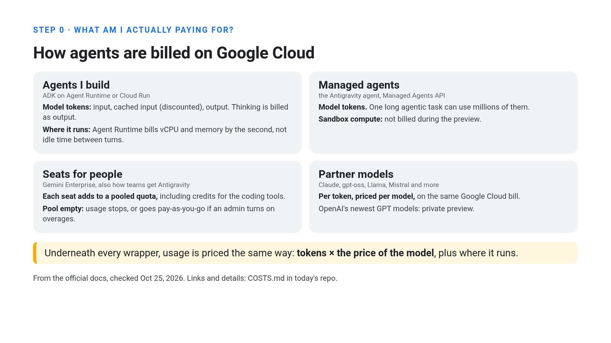

---

## Repository map

| File | Purpose |
| :--- | :--- |
| [`cost_lab/agents.py`](cost_lab/agents.py) | All ADK agents used in the walkthrough: the 6 Gemini SQL analyst variants, the Gemini 4 Argon and Claude Sonnet 5.5 variants (`ClaudeWithCache`), the router agent, and the runaway `research_agent`. |
| [`cost_lab/semantic_layer.py`](cost_lab/semantic_layer.py) | The ~8,500-token Cymbal Coffee semantic layer (table schemas, 55-term business glossary, and 20 worked SQL examples) that makes context caching and naive prompt trimming measurable. |
| [`cost_lab/tools.py`](cost_lab/tools.py) | In-memory SQLite database for Cymbal Coffee (`run_sql`, `get_schema`) and the `check_report_status` tool that simulates a stuck upstream job (`status: "PENDING"`). |
| [`cost_lab/eval_harness.py`](cost_lab/eval_harness.py) | Runs the 8 analyst questions in a single multi-turn session per variant, scores answers against ground-truth SQLite numbers + an LLM judge, and records `tokens_per_successful_task`. |
| [`run_lab.py`](run_lab.py) | CLI entrypoint (`summary`, `experiments`, `loop`, `burn-rate`, `all`). |
| [`sql/burn_rate_by_agent.sql`](sql/burn_rate_by_agent.sql) | BigQuery query over the linked Cloud Trace `_AllSpans` table that ranks agents by input tokens, LLM calls per session, and cache hit rate. |
| [`infra/token_burn_alert.json`](infra/token_burn_alert.json) | Cloud Monitoring alerting policy (PromQL over `gen_ai.client.token.usage`) that pages in minutes when any `gen_ai.agent.name` burns more than 10,000 tokens/min. |
| [`infra/deploy_cloud_run.sh`](infra/deploy_cloud_run.sh) | Deploys [`deploy/sql_analyst`](deploy/sql_analyst) to Cloud Run with `--max-instances=3 --concurrency=8 --timeout=120s`. |
| [`COSTS.md`](COSTS.md) | Deep dive into how agents are billed on Google Cloud and recent billing features (Spend Cap budgets, AI cost anomalies, Gemini Cloud Assist root-cause analysis, and Gemini Enterprise controls). |
| [`out/`](out/) | Pre-recorded JSON results from the real Google Cloud runs shown in the episode (`experiments_summary.json`, `loop.json`, `burn_rate.json`). |

---

## Quickstart

### 1. Clone, install, and run the offline verification (no cloud credentials required)

You can inspect the pre-recorded experiment tables and run the 16 offline unit tests immediately without a Google Cloud project:

```bash
git clone https://github.com/danielazamorah/agent-cost-controls.git
cd agent-cost-controls

python3 -m venv .venv
source .venv/bin/activate
pip install -e ".[dev]"

# Verify the semantic layer, ground-truth SQL answers, agent configs, and pre-recorded results:
pytest -q

# Print the pre-recorded tables from out/ (experiments, loop vs bounded, and BigQuery burn rate):
python run_lab.py summary
```

### 2. Configure your Google Cloud project (to run live against Agent Platform)

To run the live experiments and emit OpenTelemetry spans to Cloud Trace, Cloud Logging, and Cloud Monitoring:

```bash
gcloud auth application-default login

export GOOGLE_CLOUD_PROJECT="your-gcp-project-id"
export GOOGLE_CLOUD_LOCATION="global"
export GOOGLE_GENAI_USE_VERTEXAI=TRUE
export BQ_TRACE_DATASET="agent_spans"
```

> **Link Cloud Trace to BigQuery (one-time setup per project):**
> In the Google Cloud Console, open **Trace -> Settings -> Link to BigQuery** and link your trace data to a BigQuery dataset named `agent_spans`. Cloud Trace will populate the `agent_spans._AllSpans` table used by `sql/burn_rate_by_agent.sql` and `python run_lab.py burn-rate`.

---

## Code Walkthrough

### Part 1: The Developer View (Cost Next to Quality)

#### Step 1.1 & 1.2: Put cost next to quality (`python run_lab.py experiments`)

In [`cost_lab/agents.py`](cost_lab/agents.py), we build a SQL analyst agent for **Cymbal Coffee** that answers 8 multi-turn business questions (such as *"What was net revenue in EMEA in Q3 2026?"* and *"Which loyalty tier had the highest gross margin in September 2026?"*).

To answer those questions accurately, the agent needs [`SEMANTIC_LAYER`](cost_lab/semantic_layer.py) (~8,500 tokens of table schemas, metric formulas like `net_revenue_usd` that exclude `cancelled` and `refunded` orders and subtract `discount_usd`, and 20 worked SQL queries).

We test one change at a time in [`cost_lab/agents.py`](cost_lab/agents.py):

1. **`baseline` (`sql_baseline`):** Prepends a dynamic per-request header (`request_id=... timestamp=...`) in front of `SEMANTIC_LAYER` inside `instruction=...`, with `thinking_level="HIGH"`. Because the first line changes on every turn, prefix caching cannot reuse the 8,500-token semantic layer (`0%` cache hit rate).
2. **`thinking_medium` (`sql_thinking_medium`) & `thinking_low` (`sql_thinking_low`):** Lowers `ThinkingConfig(thinking_level=...)` from `"HIGH"` to `"MEDIUM"` and `"LOW"`. On this schema-guided SQL task, accuracy stays `8/8`, while thinking tokens drop from `4,536` to `1,562` and latency drops from `9.4s` to `5.6s` per question.
3. **`static_first` (`sql_static_first`):** Moves `SEMANTIC_LAYER` into ADK's `static_instruction=` field and keeps only the dynamic per-request header in `instruction=`. With `ContextCacheConfig(min_tokens=4096, ttl_seconds=600)` enabled on `App(...)`, cache hits jump from `0%` to **`94%` of LLM calls** (`70%` of all input tokens read from cache).
4. **`no_glossary` (`sql_no_glossary`):** The naive "cost optimization" that deletes `SEMANTIC_LAYER` to make the prompt look small and forces the agent to discover schemas via `get_schema()`. Without the metric definitions, the agent guesses column names, hits SQL errors, retries in loops (`19 -> 38` LLM calls), burns **more** total input tokens (`233,395 -> 550,885`), and collapses in quality (**`8/8 -> 2/8`**).
5. **`best` (`sql_best`):** Combines `static_instruction=SEMANTIC_LAYER` with `thinking_level="LOW"`. Keeps **`8/8`** accuracy while cutting tokens per successful task from `30,034` to **`19,900`** (`154,599` input tokens across the 8-question session, `94%` of calls from cache).

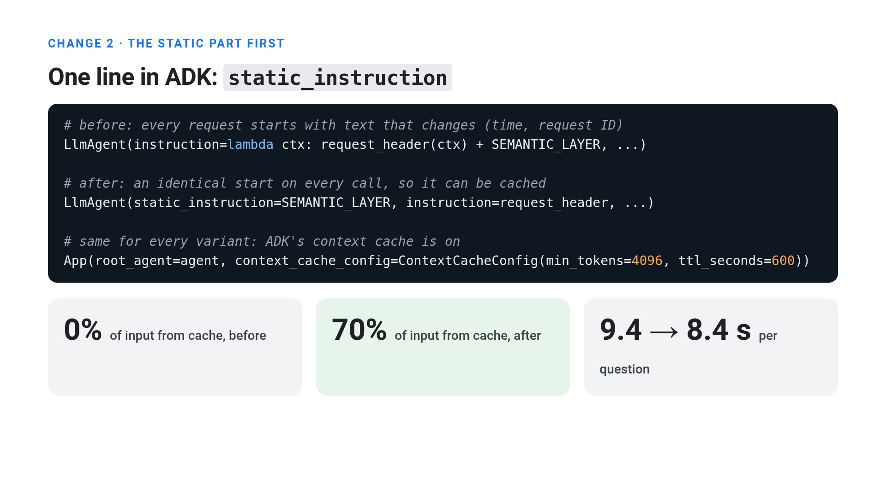

Run the 6 Gemini variants and the evaluation harness:

```bash
python run_lab.py experiments
```

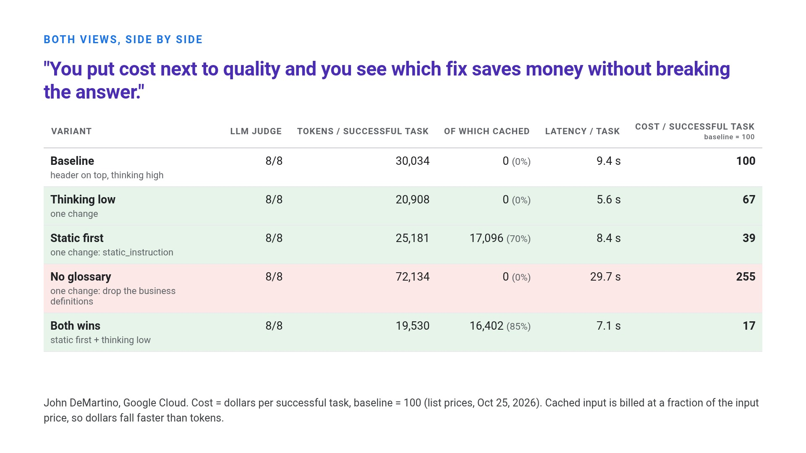

##### Comparing models (`RUN_ALL_MODELS=1`)

You can also run the exact same 8-question benchmark across **Gemini 3.8 Flash**, **Gemini 4 Argon**, and **Anthropic Claude Sonnet 5.5 on Vertex AI** (including Anthropic's explicit prompt caching via `cache_control={"type": "ephemeral"}` in `ClaudeWithCache`):

```bash
export VERTEX_CLAUDE_LOCATION="us-east5"
RUN_ALL_MODELS=1 python run_lab.py experiments
```

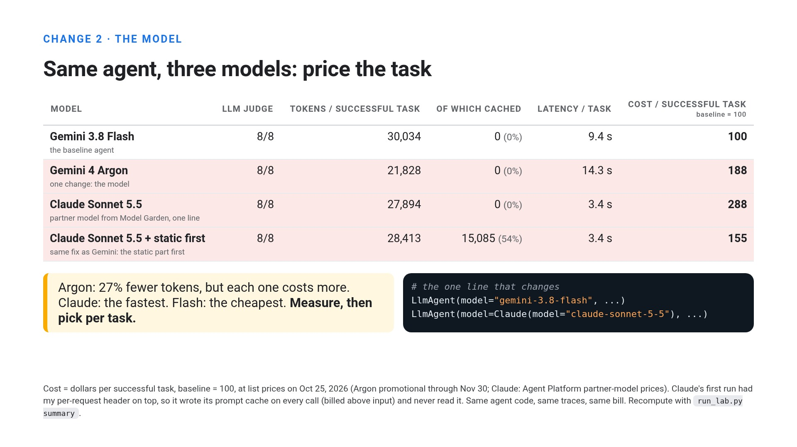

---

#### Step 1.3: Bound the loop inside the agent (`python run_lab.py loop`)

Prompt and model tuning reduce the cost of normal turns, but they will not save you when an agent enters a retry loop.

In [`cost_lab/agents.py`](cost_lab/agents.py), `make_research_agent()` calls `check_report_status("q3-market")` in [`cost_lab/tools.py`](cost_lab/tools.py), which always returns `{"status": "PENDING", "progress": "generating"}`.

By default, ADK's `RunConfig.max_llm_calls` is **`500`**. When you pass `RunConfig(max_llm_calls=8)` to `runner.run_async(..., run_config=RunConfig(max_llm_calls=8))`, ADK's `InvocationContext.increment_llm_call_count()` raises `LlmCallsLimitExceededError` as soon as the 9th model call is attempted.

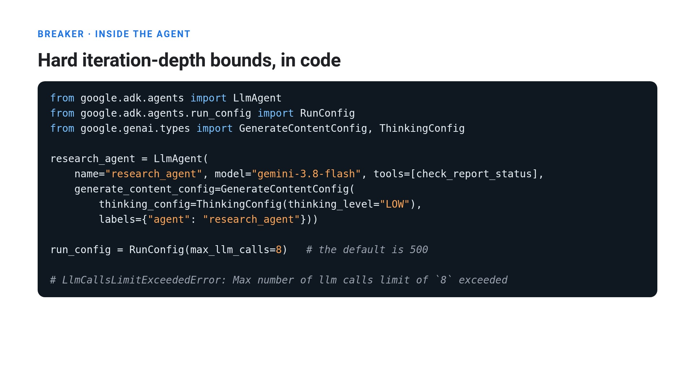

Run the side-by-side loop comparison:

```bash
python run_lab.py loop
```

In **Cloud Trace**, you can see the difference immediately:

1. **Without a tight bound (`max_llm_calls=40` safety net for the demo):** the agent repeats `call_llm -> execute_tool check_report_status` 40 times in a row, re-sending the growing conversation history every time and burning **49,336 input tokens** over **53.5 seconds** for zero useful output:

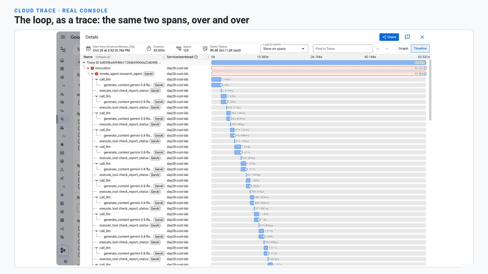

2. **Every model span records which agent spent the tokens:** clicking any `generate_content` span in Cloud Trace shows `gen_ai.agent.name`, `gen_ai.conversation.id`, `gen_ai.request.model`, `gen_ai.usage.input_tokens`, `gen_ai.usage.output_tokens`, and `gen_ai.usage.reasoning.output_tokens`:

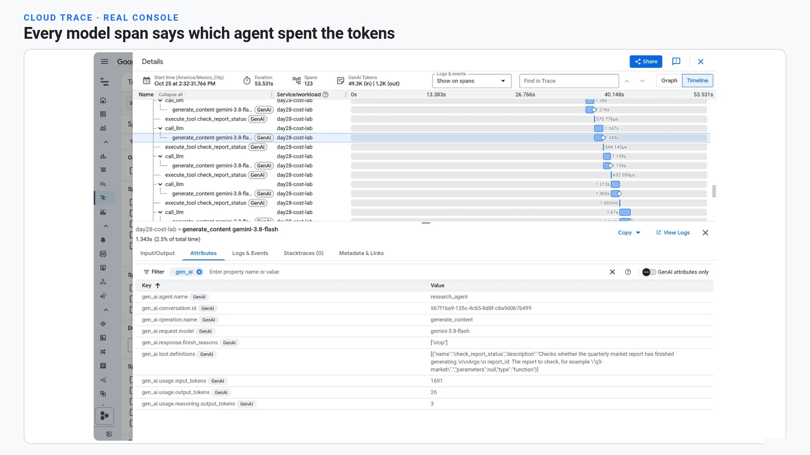

3. **With `RunConfig(max_llm_calls=8)`:** the exact same agent stops cleanly at 8 calls (**4,946 input tokens**, **10.6 seconds**, **90% fewer tokens burned**):

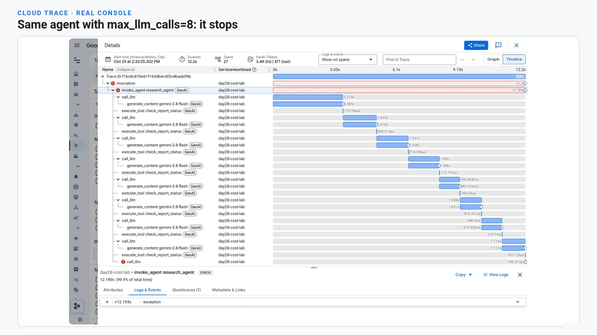

---

### Part 2: The Organization View (Alarms, Attribution, and Hard Caps)

When an entire engineering org is deploying agents, you need controls that work across two different clock speeds:
- **Minutes (Cloud Monitoring + Cloud Trace):** catch runaway token velocity while a loop is still happening.
- **Hours (Cloud Billing):** attribute actual dollar spend by agent label and enforce project/service spend caps.

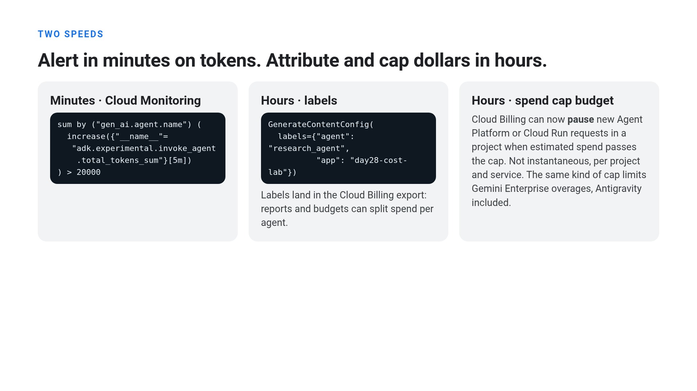

---

#### Step 2.1: Find your hungriest agent in BigQuery and alert in minutes

Once Cloud Trace is linked to BigQuery (`agent_spans._AllSpans`), every agent run across your project lands in a single queryable table, including partner models like Claude on Vertex AI.

Run the burn-rate query from the CLI (or paste [`sql/burn_rate_by_agent.sql`](sql/burn_rate_by_agent.sql) into BigQuery Studio):

```bash
python run_lab.py burn-rate
```

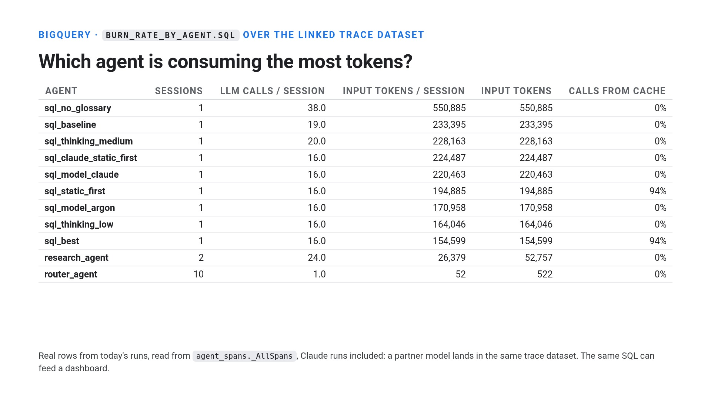

To get paged automatically within minutes instead of checking a dashboard, create the Cloud Monitoring PromQL alert policy in [`infra/token_burn_alert.json`](infra/token_burn_alert.json), which sums `gen_ai.client.token.usage` (or `adk.experimental.invoke_agent.total_tokens`) grouped by `gen_ai.agent.name`:

```bash
gcloud alpha monitoring policies create --policy-from-file=infra/token_burn_alert.json
```

Here is the real Cloud Monitoring alert incident that fired when `research_agent` ran its polling loop:

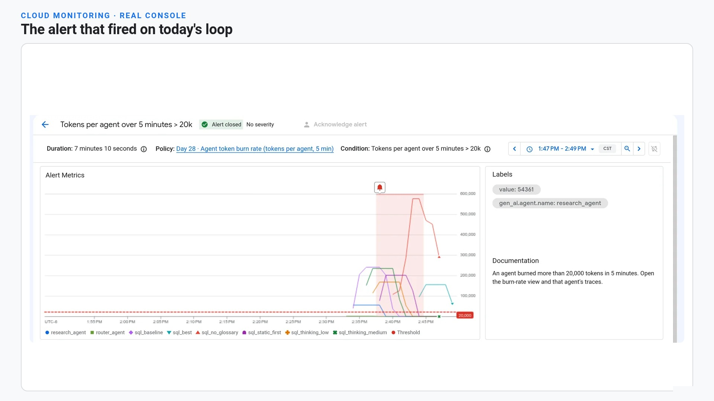

---

#### Step 2.2: Attribute the dollars in Cloud Billing with `labels`

Telemetry tells you **tokens**; Cloud Billing tells you **dollars** (after cached-token discounts, CUDs, and credits). Every agent in [`cost_lab/agents.py`](cost_lab/agents.py) and [`deploy/sql_analyst/agent.py`](deploy/sql_analyst/agent.py) attaches custom key-value labels to `GenerateContentConfig`:

```python
generate_content_config=GenerateContentConfig(
    labels={"agent": "sql_analyst", "app": "day28-cost-lab"},
    thinking_config=ThinkingConfig(thinking_level="LOW"),
)
```

Those labels flow into your Cloud Billing export to BigQuery (`SELECT labels.value AS agent, SUM(cost) FROM ... UNNEST(labels) WHERE labels.key = 'agent'`) and appear directly in the **Cloud Billing Budgets** scope filter:

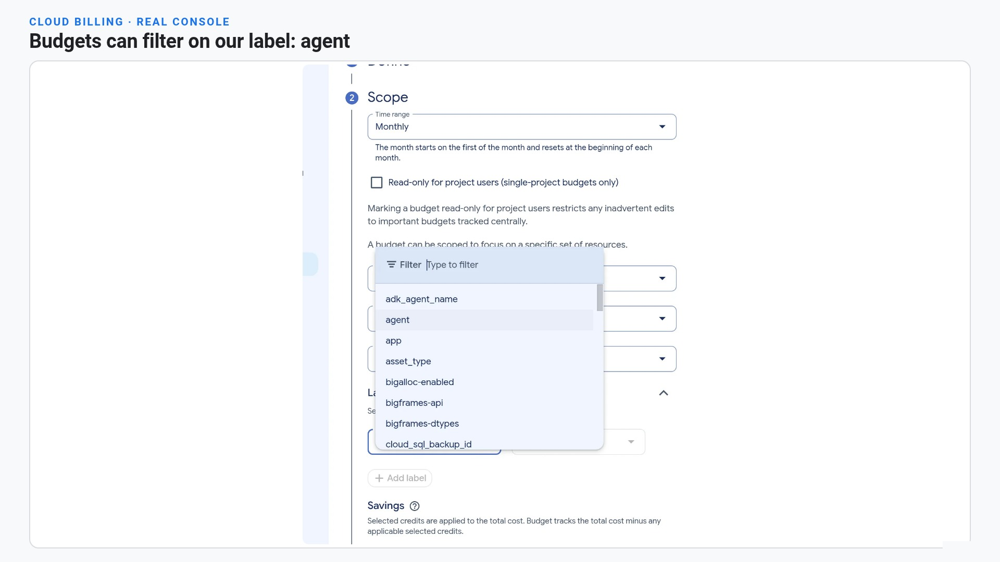

---

#### Step 2.3: Cap the spend around the agent

Even if someone deploys an agent that forgets `RunConfig(max_llm_calls=...)`, infrastructure caps around the agent hold the line:

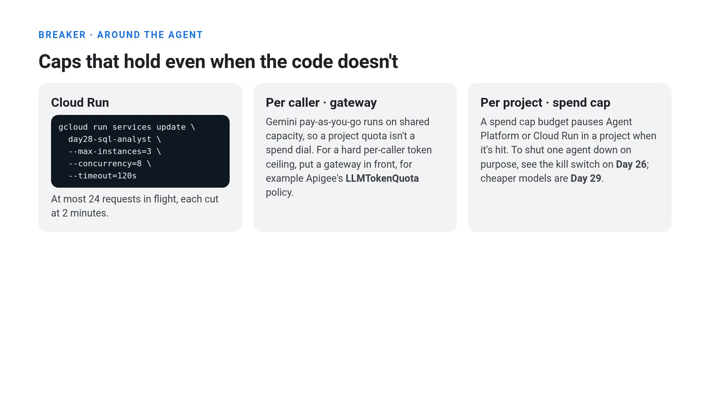

1. **Cloud Run instance, concurrency, and timeout bounds ([`infra/deploy_cloud_run.sh`](infra/deploy_cloud_run.sh)):**
   Deploy the SQL analyst agent service with hard Cloud Run bounds so traffic spikes cannot scale past `3 instances x 8 concurrent requests = 24 requests in flight`, and any hung request is cut off at `120 seconds`:

   ```bash
   PROJECT_ID="$GOOGLE_CLOUD_PROJECT" REGION="us-central1" bash infra/deploy_cloud_run.sh
   ```

   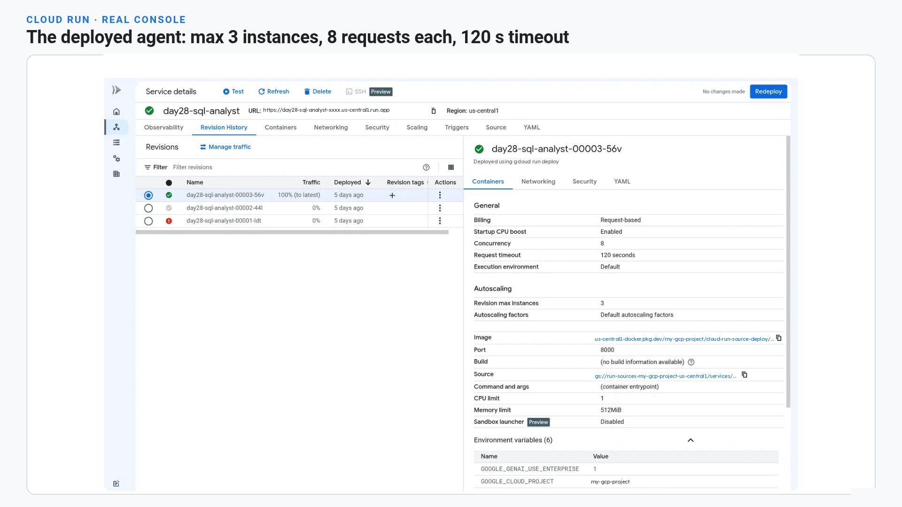

2. **Cloud Billing Spend Cap budgets:**
   When creating a budget in **Cloud Billing -> Budgets & alerts**, select **Spend cap enforcement** instead of *Alerts only*. When estimated spend crosses your threshold, Google Cloud automatically pauses the scoped service (such as Agent Platform or Cloud Run) in that project until you lift the cap:

   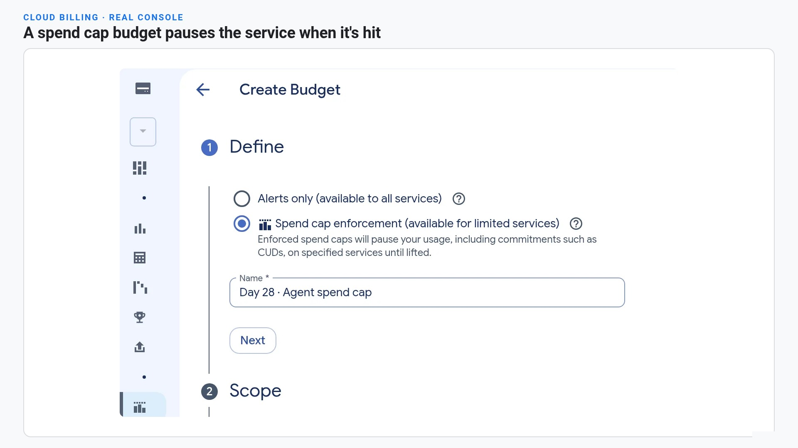

---

## License

Apache 2.0. See [`LICENSE`](LICENSE).
